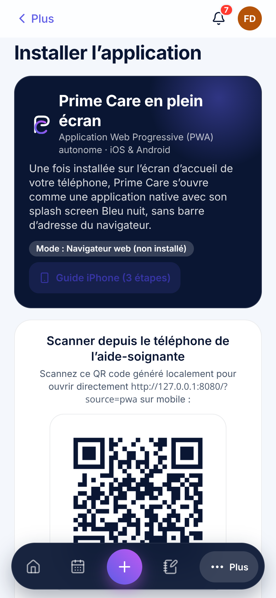
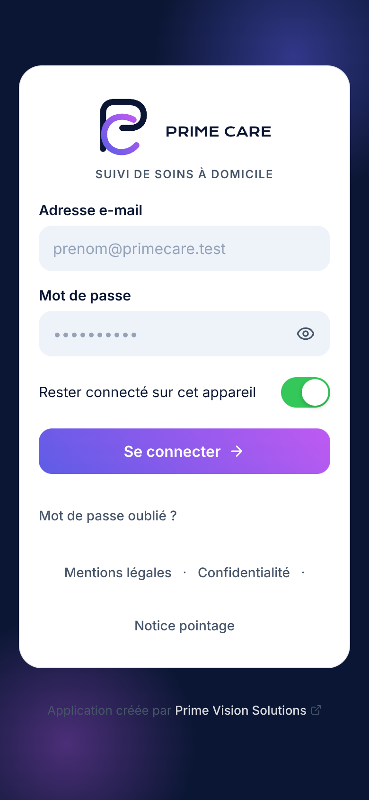
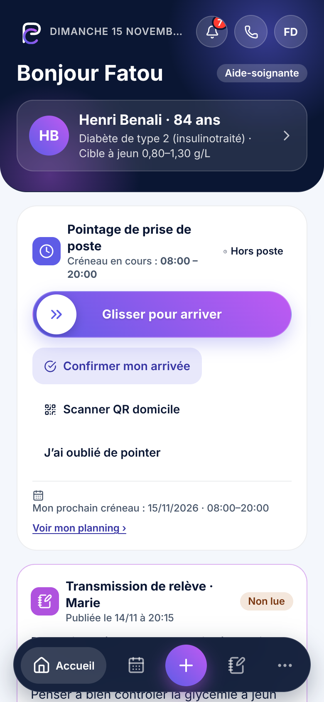
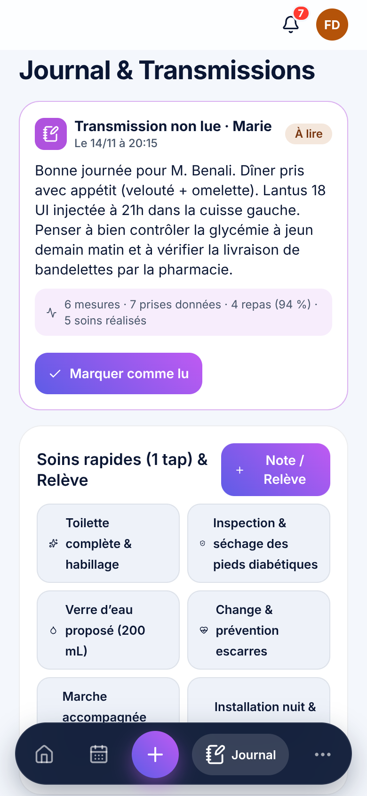
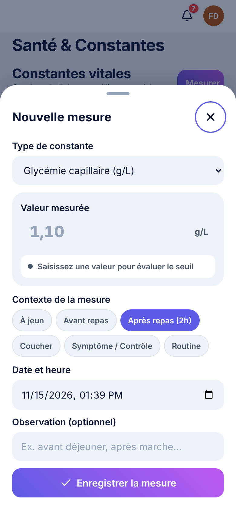
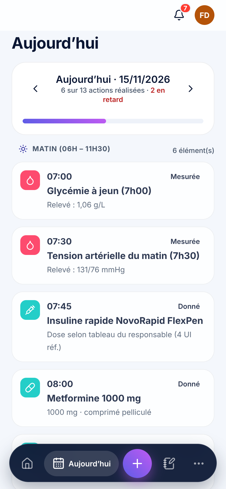
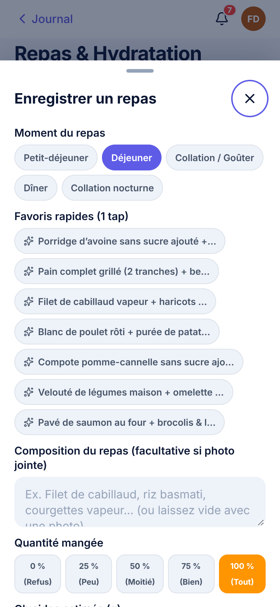
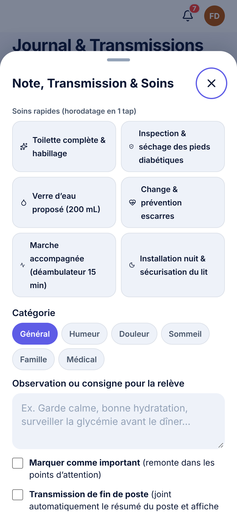
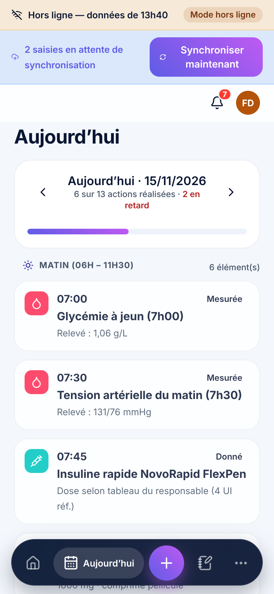

# Guide de l'Aide-Soignante — Prime Care v1.0.0

Ce guide pas-à-pas présente chacune des tâches quotidiennes de l'aide-soignante dans **Prime Care** sur téléphone mobile (`390 × 844`), illustrée par sa capture d'écran réelle.

---

## 1. Installer l'application sur son téléphone (iPhone / Android)

Pour accéder à Prime Care en plein écran depuis l'écran d'accueil de votre téléphone :
1. Ouvrez le menu **Plus (`⋯`) > Installer l'application** (`/install`) ou scannez le QR code affiché.
2. **Sur iPhone (Safari)** :
   - Appuyez sur le bouton **Partager** (carré avec flèche vers le haut) en bas de Safari.
   - Choisissez **« Sur l'écran d'accueil »**, puis appuyez sur **« Ajouter »**.
3. **Sur Android (Chrome)** :
   - Appuyez sur **« Installer l'application »** dans la bannière proposée par Prime Care (ou ouvrez le menu `⋮` de Chrome > **« Installer l'application »**).

---

## 2. Se connecter (mot de passe au premier usage, puis code PIN à 4 chiffres)

1. **Première connexion sur votre téléphone** :
   - Saisissez votre **adresse e-mail** et votre **mot de passe** personnel sur `/login`, puis appuyez sur **« Se connecter »**.
   - Ouvrez ensuite **Plus (`⋯`) > Mon profil** (`/profile`), définissez votre **code PIN à 4 chiffres** et appuyez sur **« Autoriser le code PIN sur cet appareil (90 jours) »**.
2. **Connexions suivantes (en 2 secondes)** :
   - Sur un téléphone de confiance autorisé, touchez simplement votre avatar et tapez vos **4 chiffres de code PIN** (`/login/pin`).
   - Pour passer le téléphone du domicile à votre collègue lors de la relève, appuyez sur votre avatar en haut à droite > **« Changer d'intervenant »** (`/login/switch`).

---

## 3. Pointer son arrivée et son départ (bouton glissant, QR code ou oubli)

Lors de votre **tout premier pointage**, l'application affiche la **notice d'information RGPD** expliquant pourquoi l'heure et la distance au domicile sont vérifiées au moment précis du pointage (sans aucun suivi en continu) : validez **« J'ai lu et compris »** une seule fois.

Ensuite, à chaque garde sur l'écran **Accueil** (`/`) :
1. **En arrivant au domicile** :
   - Faites glisser le bouton **« Glisser pour arriver »** vers la droite (ou appuyez sur **« Scanner QR domicile »** pour viser l'affiche plastifiée de l'entrée).
   - Si vous êtes hors du rayon GPS ou si la géolocalisation est désactivée, **le pointage n'est jamais bloqué** : votre arrivée est enregistrée avec la mention *« À valider »* pour le responsable.
2. **En quittant votre garde** :
   - Faites glisser **« Glisser pour partir »** : l'application enregistre votre départ et vous propose d'ouvrir directement votre transmission de fin de poste.
3. **En cas d'oubli** :
   - Appuyez sur **« J'ai oublié de pointer »**, indiquez le créneau et le motif : la déclaration est transmise au responsable.

---

## 4. Lire la transmission de la collègue précédente

Dès votre prise de poste :
1. Sur l'**Accueil** (`/`) ou dans l'onglet **Journal** (`/journal`), un encart met en évidence la **Transmission de relève** laissée par votre collègue précédente ainsi que le résumé automatique de sa garde.
2. Prenez connaissance des consignes et événements signalés, puis appuyez sur le bouton **« J'ai lu »** : le bandeau est acquitté pour votre poste.

---

## 5. Saisir une glycémie en 3 touches & Réaction de l'application en cas d'hypoglycémie

### Saisir une glycémie en 3 touches
1. **Touche 1** : Appuyez sur le bouton central **`+`** de la barre du bas (ou sur **« Mesurer »** dans **Aujourd'hui** / **Santé**).
2. **Touche 2** : Tapez la valeur lue sur le lecteur (ex. `1,10`) et vérifiez la puce de contexte pré-sélectionnée selon l'heure (*À jeun*, *Avant repas*, *Après repas (2h)*, *Coucher*).
3. **Touche 3** : Appuyez sur **« Enregistrer la mesure »**.

### Comment l'application réagit en cas d'hypoglycémie
- Dès qu'une glycémie enregistrée est inférieure au seuil d'hypoglycémie configuré pour le patient, **l'application ouvre automatiquement la fiche protocole d'hypoglycémie** à l'écran et déclenche une alerte critique vers le responsable.
- Cette fiche affiche **le protocole défini par le responsable avec le médecin traitant dans l'écran Réglages (`/settings`)** : suivez strictement les consignes personnalisées qui s'affichent à l'écran.
- La fiche protocole ainsi que l'en-tête de l'application mettent immédiatement à votre disposition le **bouton SOS / Urgences** (icône téléphone) permettant d'**appeler en 1 touche** le responsable, le médecin traitant ou les secours (**SAMU 15 / 112**).

---

## 6. Valider une prise de médicament ou une injection d'insuline

Dans l'onglet **Aujourd'hui** (`/today`) :
1. **Médicament à dose fixe** (ex. *Metformine 1000 mg*) :
   - Appuyez en **1 touche** sur le bouton **« Donné »** de la carte horaire.
   - Si une collègue vient déjà de valider cette prise sur son téléphone, l'application bloque le doublon et affiche *« Déjà donné par [Prénom] à [Heure] »*.
2. **Insuline à dose variable selon la glycémie** (ex. *NovoRapid FlexPen*) :
   - Appuyez sur **« Grille & Injecter »**.
   - L'application lit votre dernière glycémie, surligne automatiquement la **dose en UI selon le tableau du responsable**, et vous propose le **prochain site d'injection** dans la rotation (*Abdomen gauche -> Abdomen droit -> Cuisse gauche -> Cuisse droite -> Bras gauche -> Bras droit*).
   - Vérifiez la dose et le site puis appuyez sur **« Confirmer l'injection »**.
3. **Prise non donnée** :
   - Appuyez sur **« Non pris »** et sélectionnez obligatoirement le motif (*Refus du patient*, *Patient endormi*, *Vomissements / Nausées*, *Rupture de stock*, *Avis médical*).

---

## 7. Prendre en photo un repas et saisir l'hydratation

1. Appuyez sur **`+` > Repas / Hydratation** (ou ouvrez **Plus > Repas & Hydratation** `/meals` > **« Saisir un repas »**).
2. Le type de repas (*Petit-déjeuner*, *Déjeuner*, *Collation*, *Dîner*) est pré-sélectionné automatiquement selon l'heure.
3. Appuyez sur **« Ajouter une photo »** pour photographier l'assiette (une photo seule suffit, ou complétez la description), choisissez la **portion mangée** (`0 %`, `25 %`, `50 %`, `75 %`, `100 %`) et la quantité bue en `mL`, puis appuyez sur **« Enregistrer le repas »**.

---

## 8. Rédiger la transmission de fin de poste

À la fin de votre garde :
1. Ouvrez l'onglet **Journal** (`/journal`) et appuyez sur **« Rédiger la relève »** (ou laissez-vous guider après avoir glissé **« Glisser pour partir »**).
2. L'application pré-remplit automatiquement le **récapitulatif de votre garde** (dernière glycémie mesurée, prises administrées ou non données, repas et hydratation).
3. Ajoutez vos observations cliniques ou consignes pour la collègue suivante et appuyez sur **« Publier la transmission de relève »**.

---

## 9. Travailler sans réseau (mode hors ligne & synchronisation)

Si la connexion Wi-Fi ou 4G/5G est coupée dans une pièce du domicile :
1. **Bandeau d'état hors ligne** :
   - Un bandeau ambre **« Hors ligne — données de [Heure] · Mode hors ligne »** apparaît en haut de l'écran.
   - Les écrans principaux (**Accueil**, **Aujourd'hui**, **Journal**) restent consultables grâce au cache sécurisé de l'application.
2. **Saisir normalement pendant la coupure** :
   - Continuez d'enregistrer vos **glycémies, constantes, prises de médicaments, repas, notes et soins rapides** exactement comme d'habitude.
   - Chaque saisie est horodatée à **l'heure réelle de votre geste** et stockée en sécurité dans la file d'attente locale du téléphone (`IndexedDB`).
   - Une barre bleue affiche le compteur : **« X saisie(s) en attente de synchronisation »**.
3. **Synchronisation automatique au retour du réseau** :
   - Dès que le téléphone retrouve le réseau (ou lorsque vous appuyez sur **« Synchroniser maintenant »**), toutes les saisies en attente sont envoyées automatiquement au serveur sans aucun doublon (`client_uuid`).
   - Si une prise a été validée entre-temps par une collègue, l'application vous en informe sans bloquer le reste de vos saisies.
